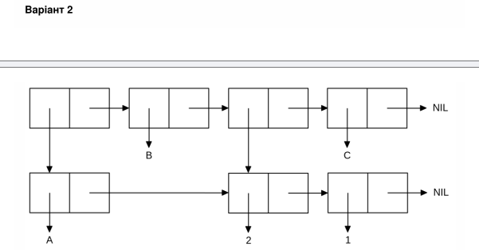

<p align="center"><b>МОНУ НТУУ КПІ ім. Ігоря Сікорського ФПМ СПіСКС</b></p>

<p align="center">
<b>Звіт з лабораторної роботи 1</b><br/>
"Обробка списків з використанням базових функцій"<br/>
дисципліни "Вступ до функціонального програмування"
</p>

<p align="right"><b>Студент(-ка)</b>: Вальчишен Святослав Русланович, КВ-34</p>
<p align="right"><b>Рік</b>: 2026</p>

## Загальне завдання

```lisp
;; Пункт 1. Створення списку з 5 елементів (символ, число, непустий підсписок, пустий підсписок).
;; Використано функції LIST та CONS. Збережено у змінну my-list.
CL-USER> (setq my-list (list 'my-sym 42 (cons 1 (cons 2 nil)) nil (list 'x 'y)))
(MY-SYM 42 (1 2) NIL (X Y))

;; Пункт 2. Отримати голову списку.
CL-USER> (car my-list)
MY-SYM

;; Пункт 3. Отримати хвіст списку.
CL-USER> (cdr my-list)
(42 (1 2) NIL (X Y))

;; Пункт 4. Отримати третій елемент списку.
CL-USER> (third my-list)
(1 2)

;; Пункт 5. Отримати останній елемент списку.
CL-USER> (car (last my-list))
(X Y)

;; Пункт 6. Використання предикатів ATOM та LISTP на різних елементах.
CL-USER> (atom (car my-list))
T
CL-USER> (atom (third my-list))
NIL
CL-USER> (listp (third my-list))
T
CL-USER> (listp (car my-list))
NIL

;; Пункт 7. Використання інших предикатів (NUMBERP, SYMBOLP, NULL).
CL-USER> (numberp (second my-list))
T
CL-USER> (symbolp (car my-list))
T
CL-USER> (null (fourth my-list))
T

;; Пункт 8. Об'єднання створеного списку з одним із його непустих підсписків за допомогою APPEND.
CL-USER> (append my-list (third my-list))
(MY-SYM 42 (1 2) NIL (X Y) 1 2)
```

## Варіант 2

<p align="center">

</p>

```lisp
CL-USER> (let ((sublist (list 2 1)))
           (list (cons 'A sublist) 'B sublist 'C))
((A 2 1) B (2 1) C)
```
