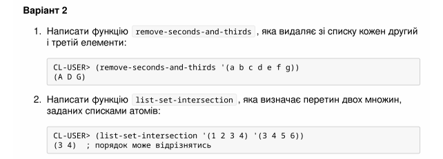

<p align="center"><b>МОНУ НТУУ КПІ ім. Ігоря Сікорського ФПМ СПіСКС</b></p>

<p align="center">
<b>Звіт з лабораторної роботи 2</b><br/>
"Рекурсія"<br/>
дисципліни "Вступ до функціонального програмування"
</p>

<p align="right"><b>Студент(-ка)</b>: Вальчишен Святослав Русланович, КВ-34</p>
<p align="right"><b>Рік</b>: 2026</p>

## Загальне завдання

Реалізуйте дві рекурсивні функції, що виконують деякі дії з вхідним(и) списком(-ами), за можливості/необхідності використовуючи різні види рекурсії. Вимоги до функцій:
1. Зміна списку згідно із завданням має відбуватись за рахунок конструювання нового списку, а не зміни наявного (вхідного).
2. Не допускається використання функцій вищого порядку чи стандартних функцій для роботи зі списками, що не наведені в четвертому розділі навчального посібника.
3. Реалізована функція не має бути функцією вищого порядку, тобто приймати функції в якості аргументів.
4. Не допускається використання псевдофункцій (деструктивного підходу).
5. Не допускається використання циклів.
Кожна реалізована функція має бути протестована для різних тестових наборів. Тести мають бути оформлені у вигляді модульних тестів.

## Варіант 2

<p align="center">

</p>

## Лістинг функції remove-seconds-and-thirds

```lisp
(defun remove-seconds-and-thirds (lst)
  "Видаляє зі списку кожен другий і третій елементи."
  (cond ((null lst) nil)
        ((null (cdr lst)) (list (car lst)))
        ((null (cddr lst)) (list (car lst)))
        (t (cons (car lst)
                 (remove-seconds-and-thirds (cdddr lst))))))
```

### Тестові набори та утиліти

```lisp
(defun check-remove-seconds-and-thirds (name input expected)
  "Виконує remove-seconds-and-thirds для input, порівнює з expected і друкує результат."
  (format t "~:[FAILED~;passed~]... ~a~%"
          (equal (remove-seconds-and-thirds input) expected)
          name))

(defun test-remove-seconds-and-thirds ()
  (check-remove-seconds-and-thirds "test 1 (from example)" '(a b c d e f g) '(a d g))
  (check-remove-seconds-and-thirds "test 2 (empty list)" nil nil)
  (check-remove-seconds-and-thirds "test 3 (one element)" '(1) '(1))
  (check-remove-seconds-and-thirds "test 4 (two elements)" '(1 2) '(1))
  (check-remove-seconds-and-thirds "test 5 (three elements)" '(1 2 3) '(1))
  (check-remove-seconds-and-thirds "test 6 (four elements)" '(1 2 3 4) '(1 4)))
```

### Тестування

```lisp
CL-USER> (test-remove-seconds-and-thirds)
passed... test 1 (from example)
passed... test 2 (empty list)
passed... test 3 (one element)
passed... test 4 (two elements)
passed... test 5 (three elements)
passed... test 6 (four elements)
NIL
```

## Лістинг функції list-set-intersection

```lisp
(defun is-in-list (elem lst)
  "Допоміжна рекурсивна функція для перевірки наявності елемента у списку."
  (cond ((null lst) nil)
        ((eql elem (car lst)) t)
        (t (is-in-list elem (cdr lst)))))

(defun list-set-intersection (set1 set2)
  "Визначає перетин двох множин, заданих списками атомів."
  (cond ((null set1) nil)
        ((is-in-list (car set1) set2)
         (cons (car set1) (list-set-intersection (cdr set1) set2)))
        (t (list-set-intersection (cdr set1) set2))))
```

### Тестові набори та утиліти

```lisp
(defun check-list-set-intersection (name input1 input2 expected)
  "Виконує list-set-intersection, порівнює результат з expected і друкує статус."
  (format t "~:[FAILED~;passed~]... ~a~%"
          (equal (list-set-intersection input1 input2) expected)
          name))

(defun test-list-set-intersection ()
  (check-list-set-intersection "test 1 (from example)" '(1 2 3 4) '(3 4 5 6) '(3 4))
  (check-list-set-intersection "test 2 (no intersection)" '(1 2) '(3 4) nil)
  (check-list-set-intersection "test 3 (both empty)" nil nil nil)
  (check-list-set-intersection "test 4 (one empty)" '(1 2 3) nil nil)
  (check-list-set-intersection "test 5 (full intersection)" '(a b c) '(c b a) '(a b c)))
```

### Тестування

```lisp
CL-USER> (test-list-set-intersection)
passed... test 1 (from example)
passed... test 2 (no intersection)
passed... test 3 (both empty)
passed... test 4 (one empty)
passed... test 5 (full intersection)
NIL
```
